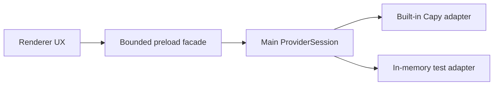

# Desktop provider boundary

The shell talks to `desk.provider`; only the main process selects a compiled-in adapter. The first production adapter is Capy. There is no plugin loader, provider URL field, renderer credential access, new network service, or live second-provider integration.

## Contract in use

`preload.cjs` exposes named methods, not arbitrary RPC or HTTP. Native connection/key storage, clipboard, global appearance/keymap settings and media actions stay on `desk`. Account-scoped workspace settings use the context-bound facade but remain a native sidecar, not a backend adapter obligation. The original data-method aliases remain for compatibility with existing harnesses; production UX data entry points use `desk.provider`.

Preload transports plain `{value}` / `{error,code}` envelopes; the renderer's `client` reconstructs rejected Errors with stable codes. Throwing a custom Error directly across Electron's context bridge would lose its code. Stream listeners carry plain bounded batches.

| Value | Meaning |
| --- | --- |
| Provider context | `{id, name, scope, generation, capabilities}`. Scope is a hash of provider identity plus the existing account scope; it contains no credential. Every facade request carries scope/generation. Main rejects stale requests and late responses. |
| Identity/cursor | Opaque nonempty strings, at most 256 characters in the shell. Never infer timestamp/order/provider from an ID. Adapters enforce their narrower wire formats. Identity is `(provider scope, conversation ID)`; a cursor additionally belongs to that conversation and its operation. IDs are not rewritten or prefixed on the wire. |
| Project | `{id, name}`. A provider can supply a single workspace group rather than inventing a backend project system. |
| Conversation | `{id, projectId?, title?, name?, code?, status, archived?, hasUnreads?, needsYou?, owed?, queuedAt?, createdAt?, updatedAt?, lastActivityAt?, lastModelId?}`. `status` is `working`, `waiting`, `idle`, `failed`, `archived`, or `unknown`; missing/new statuses do not become idle. |
| Optional hierarchy | `parentId`, `isCaptain`, and ask `{key,text}` are compatibility DTO fields for the `captain-crew` capability, not universal conversation concepts. Unsupported providers return an empty `captains` collection and no parent linkage. |
| Workspace | `{projects, threads, captains, activity}`. These collection keys retain the shell's existing names; their items are normalized DTOs, not Capy schemas. Offline activity retains the current sample fixture. Live observed activity remains a shell projection, not invented backend completion history. |
| Content | `{id?, source, text, createdAt?, callId?, clientKey?, tool?, model?, authorName?, attachments?, references?, sender?}`. Sources used today are `user`, `assistant`, `tool`; tool text is the public summary. The adapter projects allowed fields, never arguments, results, hidden reasoning, or arbitrary backend metadata. Legacy offline rows can lack an ID. |
| Content page | `{items, cursor?, beforeCursor?}`. `cursor` continues forward; `beforeCursor` loads older records. Cursors are opaque, not message IDs inferred from content. Existing pager limits/repeated-cursor detection are unchanged. |
| Send | `send(id,text,clientKey,model?) → {id,deduped,accepted:true,delivery}`. `delivery` is `queue` for Capy, `local` for offline fixtures. Acceptance is not agent pickup, execution, or completion. A retry retains the original client key and model snapshot. |
| Model catalog | `{items:[{id,name,billing?,reasoningModes,fast?,pro?,ultrafast?}],default:{modelId}}`. Missing mode flags mean unsupported. The three named optional mode flags are the current compatibility vocabulary, not a claim every provider has them. |
| Model metadata | `metadata(id) → {id,lastModelId}`. Capy exposes a last-reported ID, not actual current reasoning/modes. Selection applies to the next sent message only. Runtime/machine movement remains unsupported and explicitly unknown. |
| Read | `readState(id)` and `markRead({id,action,eventId?}) → {id,hasUnreads}`. Mark read requires the actual caught-up committed stream cursor. Read state stays authoritative; an unsupported provider must not fabricate it. |
| Capability | `{supported:boolean, reason?:string}` for send, stream, read, models, create, hierarchy, attachments, activity history and runtime; model selection/state add their semantics. The UX disables unsupported model/read actions, prevents creation submission, explains unavailable functions, and omits unsupported captain controls and fixture-only historical counts. Main independently enforces capabilities. |
| Error | Bounded preload errors preserve a safe message and a code: `unsupported`, `stale`, `invalid`, `unauthorized`, `forbidden`, `rate-limited`, or generic `provider`. Existing actionable Capy validation errors remain intact; transport bodies and credentials are not exposed. |

Facade methods are `info`, `workspace`, `workspaceSettings`, `saveWorkspaceSettings`, `projects`, `conversations`, `content`, `send`, `models`, `createConversation`, `metadata`, `readState`, `markRead`, `reference`, `activity`, `stream`, `ack`, `cancelContent`, and `onStream`.

## Stream contract

`stream({id,token})` replaces the active subscription; `stream(null)` cancels it. Batches contain `{id,token,context,sequence?,events}`. `context` is the provider/account scope; the shell rejects mismatching scopes and subscription tokens. `ack(token,sequence)` acknowledges only the matching applied batch, never an unseen event.

Normalized internal frame vocabulary retains the established renderer reducers: `assistant` text fragments and `tool_call` summaries keyed by `callId`; `transcript` committed content plus an opaque resume/read `id`; `status`; optional `subagent`/`task` hierarchy updates; `run`/`turn` lifecycle; `connection`; `boundary`; `reset`; `heartbeat`; `error`; `done`. A committed assistant replaces its live call preview, tools reconcile by ID, and aborted/dropped turns discard previews without inventing a commit. Capy SSE parsing, reconnect/backoff, fixed-origin auth, bounded IPC and acknowledgment-driven resume cursors remain in `stream.cjs`, owned by the Capy adapter. A second adapter emits these frames without speaking Capy SSE.

## Isolation and compatibility

Connection changes abort reads, stop streams, invalidate the provider generation, and clear send/create/attachment/workspace state. ProviderSession also discards delayed successes and failures after a switch. Facade context checks prevent an old renderer from starting a new-account request or delayed settings save with an old ID. Each renderer captures its context once; reading new provider metadata does not silently rebind it before reload. Stream callbacks capture the generation. Renderer reload clears navigation, transcripts, model choices and outgoing identities; only same-scope stashed drafts return. Alternate providers use separate workspace-settings and pin namespaces. Existing Capy workspace files and offline pin keys retain their paths; no persistence migration or credential/bundle identity change is introduced.

Credentials and network access remain main-only. `providerInfo` exposes no token, endpoint or executable path. The memory adapter is selected only by `--test-provider=memory` in the already restricted, unpackaged hidden demo harness with a temporary profile. It is not a provider-install interface.

## Validation and next bounded steps

Run `node --test provider.test.cjs`, `npm test`, `npm run dev-test`, `npm run build`, `npm run hidden-proof`, and `node provider-smoke.cjs [screenshot-directory]`. The provider smoke drives the actual hidden shell through memory-provider send/stream/model/navigation/read operations with non-Capy receipts/cursors, then switches to a mocked Capy account with colliding conversation IDs and back. Existing send, stream, connection, unread, creation and model suites cover the production adapter path.

This extraction deliberately leaves Capy-specific auth/key entry, internal reference parsing, known Drive-reference rendering, cloud creation options and safe native attachment downloads as explicit edges. Optional Dev checkpoint identity validation and native sidebar expansion/project-default settings still carry legacy identity-format/160-character bounds; reconcile those before advertising broader identities for a live second provider. Core content/receipt/read handling no longer assumes Capy event IDs. It does not generalize machine metadata, discover devices, implement model hot-swaps, add arbitrary mode keys, or offer a public provider picker. Next: extract provider-aware connection UI and reference resolution before adding another live adapter; migrate cloud creation and richer model options only when that adapter has concrete consumers. Do not make the shared UX infer captain/crew or machine semantics for it.

Capy mapping was checked against the local API docs for send-message, thread read, streaming and ThreadEncoded: queued admission/client-key deduplication, last-reported models, and distinct committed stream cursors remain unchanged.
